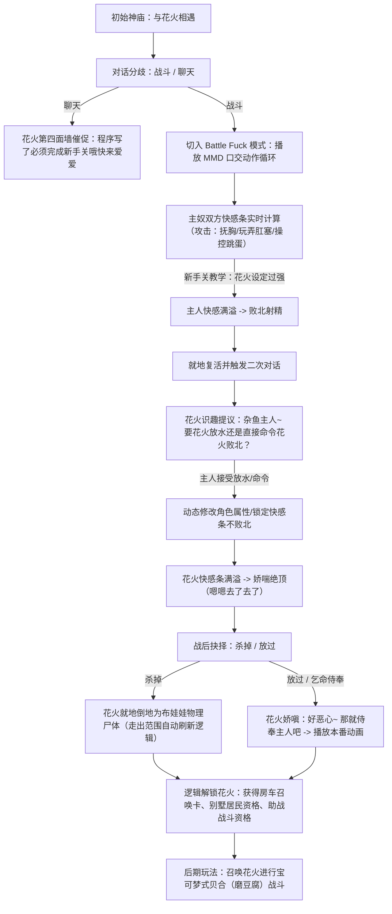

# 《Succubus Academia》（サキュバスアカデミア）深度调研与战斗机制分析

> **调研对象**：同人社团 **SQDT**（Ci-en ID: 4025）制作的 R-18 RPG 作品《サキュバスアカデミア》（DLsite 作品编号：`RJ265946`）及其大型扩展包（Append）《サキュバスアカデミア アペンド ―千変狐と自宅巫女―》（Ci-en 437340）。
> **调研目的**：深入解构其 **Battle Fuck（战斗即交配）**、**快感条与射精判定**、**败北作为游戏核心循环（败北をプレイする）** 的底层机制，并提炼其设计精髓，直接反哺并升华《Prism Route》的主人与性奴识趣玩闹、第四面墙自洽与色情轻松氛围。

---

## 一、 作品概况与核心理念

### 1. 基本信息
- **社团**：SQDT（代表作包括经典催眠/魅魔题材作品《Succubus Quest》系列、《白の史書と色づく魔物》等）。
- **DLsite 番号**：`RJ265946`。
- **创作者主页**：Ci-en creator ID 4025，DLC 发布志 [Ci-en article 437340](https://ci-en.dlsite.com/creator/4025/article/437340)。
- **核心口号**：「敗北をプレイする、新感覚RPG」（以败北为核心玩法的全新感觉 RPG）。
- **配乐风格**：由知名作曲家 **Cres.** 操刀，高辨识度的 Chiptune / Breakcore 电子芯片音（如通常战斗曲《AttaX》），兼具战斗压迫感与退废迷幻的色情张力。

### 2. 核心哲学：剥离传统死亡挫败，确立“以败北/射精为正反馈”的驱动循环
传统 RPG 的公式是：
$$\text{胜利} \rightarrow \text{推进剧情/掉落奖励} \quad / \quad \text{失败} \rightarrow \text{GameOver/惩罚回档}$$

而在《Succubus Academia》中：
- 战斗的核心目标不是物理肉体的消灭，而是性欲与快感的攻防征服。
- 败北（主角被魅魔榨干射精）不但不是游戏结束，反而是**欣赏高质量专属 H 动画/CG、解锁屈服词条、推动堕落与剧情进展的核心途径**。
- 玩家在“努力反抗尝试战胜”与“主动享受被榨取败北的快感”之间产生极其特殊的心理博弈。

---

## 二、 Battle Fuck 战斗系统机制拆解

《Succubus Academia》之所以被奉为 Battle Fuck RPG 的标杆，在于它将成人要素从“战败后的附赠品”直接提升为“战斗中的基础交互逻辑”：

### 1. 双轨/三轨数值面板（快感值替代物理血量）
在常规战斗中，角色的属性直接映射到性耐性：
- **HP / 体力**：承受身体疲劳与基础动作。
- **EP / 快感度（Pleasure Gauge）**：核心生命线。受到敌人的抚弄、言语挑逗、亲吻、口交、骑乘等不同性技攻击时，快感度急剧上涨。
- **射精限界 / 绝顶回数**：当快感度蓄满至 100% 时，立即触发“射精/绝顶判定”。根据战局阶段，可能消耗射精次数并陷入虚脱，或者直接判定战斗败北。

### 2. 状态切换：从“对峙态”进入“拘束/交尾态（Battle Fuck）”
战斗不会一直停留在隔空投掷技能：
- **接触与拘束**：魅魔使用拘束技能（如飞扑抱合、尾巴缠绕、推倒骑乘、强制口交）一旦判定命中，战斗立即从“远距离对峙”强制切入“近身性交状态”。
- **指令重构**：一旦进入拘束交尾态，主角的常规物理/魔法指令全部失效，UI 动态切换为**性对抗专用指令集**：
  - `挣扎 / 抵抗`：尝试摆脱拘束，降低被榨取效率，但会消耗大量体力。
  - `耐受 / 紧闭心神`：降低该回合的快感增加量，争取回合等待破绽。
  - `反击玩弄 / 敏感部位反攻`：反向爱抚对方的敏感点（胸部、秘所、耳朵、尾巴），试图让对方也累积快感甚至反杀。
  - `降伏 / 乞求侍奉`：彻底放弃抵抗，换取快感暴击与专属求饶台词。

### 3. 对话与动态声画反馈
- 魅魔的每一次攻击都带有轻佻、玩弄、嘲讽的文本差分（根据主角当前的快感度阶段动态改变）。
- 伴随着音效（湿润的水声、娇喘、心跳声、衣物摩擦声）与立绘/动画的激烈晃动，将“回合制指令”演化为极其具有沉浸感的“做爱攻防”。

---

## 三、 Append 扩展包《千変狐と自宅巫女》内容分析

在 Ci-en 437340 中，SQDT 发布了重磅 Append 扩展包《千変狐と自宅巫女》（Thousand-Transformation Fox and the Home Shrine Maiden），这一扩展深刻启发了日常与战斗的结构分离：

### 1. 核心扩展内容
- **新高难度/特色 Boss：千变狐（妲己 / 玉藻前系）**
  - 引入“千变”机制：战斗中会幻化为不同形态与姿势，拥有幻术、多尾拘束、极高技巧的魅惑与榨精机制。
  - 拥有极高动态难度的性技对抗，专为通关后的高难度挑战设计。
- **自宅巫女（Home Base 侍奉与支援系统）**
  - 玩家拥有了属于自己的据点（自宅/神社）。
  - “自宅巫女”在据点中提供日常侍奉、体力恢复、状态解除、性技耐性祝福与仪式加护。
  - **实现了“迷宫战斗的紧张刺激”与“自宅避风港的温馨色情侍奉”之间的强烈对比**。
- **新音乐与高难度机制拓展**
  - Cres. 为千变狐量身定制了兼具和风祭典与重低音电子的战斗 BGM。
  - 增加了更深度的调教参数与败北回放室（Gallery / 回想），让玩家能随时重温任意阶段的榨精败北演出。

---

## 四、 《Succubus Academia》的局限性与《Prism Route》的升华超越

虽然《Succubus Academia》机制非常优秀，但它依然受制于传统 RPGMaker 框架与传统的硬核数值设计。结合主人的设计要求，我们将《Prism Route》与它进行对比升华：

| 设计维度 | 《Succubus Academia》的表现 | 《Prism Route》的升华与降维打击 |
| :--- | :--- | :--- |
| **战斗表现形式** | 2D 静态立绘 + 差分切图 + 局部晃动动画 | **3D 真实口交/体位动画无缝播放**（基于 MMD 配对动作），第一/第三人称视线直击。 |
| **难度调整机制** | 硬核数值，玩家卡关必须去刷怪升级、换抗性装备，或寻找社区 MOD 修改器。 | **NPC 在对话中识趣主动提供让步与修改**！花火主动嘲讽又讨好：“要花火让让主人吗，或者主人直接命令花火败北也可以哦”。 |
| **第四面墙（Meta）** | 传统的游戏内世界观，偶尔有黑色幽默但依旧闭合在严肃剧情内。 | **彻底玩转第四面墙！** 花火主动谈论“程序写了新手关”、“机制就是走出范围就刷新”，将系统设定变为性奴讨好主人的情趣。 |
| **败北与死亡心理** | 沉沦堕落、败北收录，虽然弱化了 GameOver，但仍有“攻略挫败”感。 | **纯粹轻松的爱欲玩闹！** 绝不产生心理压力，死后尸体是就地玩弄的临时玩具，走出范围自然刷新，既不漠视生命，也绝无生存焦虑。 |
| **据点与生活联动** | Append 中的自宅巫女（固定在自宅场景的菜单式交互）。 | **房车生活与自由别墅日常！** 战胜后逻辑解锁进队伍，随时在房车/别墅召唤生活侍奉，还能作为宝可梦助战！ |
| **助战召唤形式** | 传统单人作战或常规队友回合制。 | **宝可梦式美少女对决！** 主人可以召唤花火等性奴，与其他少女展开百合磨豆腐（贝合/Tribadism）的高潮败北对决！ |

---

## 五、 《Prism Route》Battle Fuck 原型落地方案（Godot 4.7）

基于本次调研与主人的设计指令，我们在 Godot 中实现 Battle Fuck 系统的架构规划如下：

### 1. 核心状态机设计（`BattleFuckState`）
- `STATE_DIALOGUE`：剧情与第四面墙对话状态。
- `STATE_SEX_COMBAT`：性交动作播放中，玩家与 NPC 轮流通过热键/菜单执行性刺激动作。
- `STATE_INSPECTION_ADJUST`：触发濒死/二次挑战时，花火主动弹出的识趣让步分支（直接改写内存快感锁定参数）。
- `STATE_CLIMAX_SETTLEMENT`：高潮判定，根据胜负分流至射精动画或求饶侍奉。

### 2. 下一步开发动作
1. 制作专用的 `BattleFuckHUD.tscn`（包含双向快感条、主奴性技指令按钮盘、对话气泡框）。
2. 将 MMD 配对动画（口交动作循环）接入战斗场景摄像机。
3. 将花火的识趣对话树（包含败北嘲讽、第四面墙放水、尸体刷新玩笑、乞命侍奉）以代码完整驱动。
