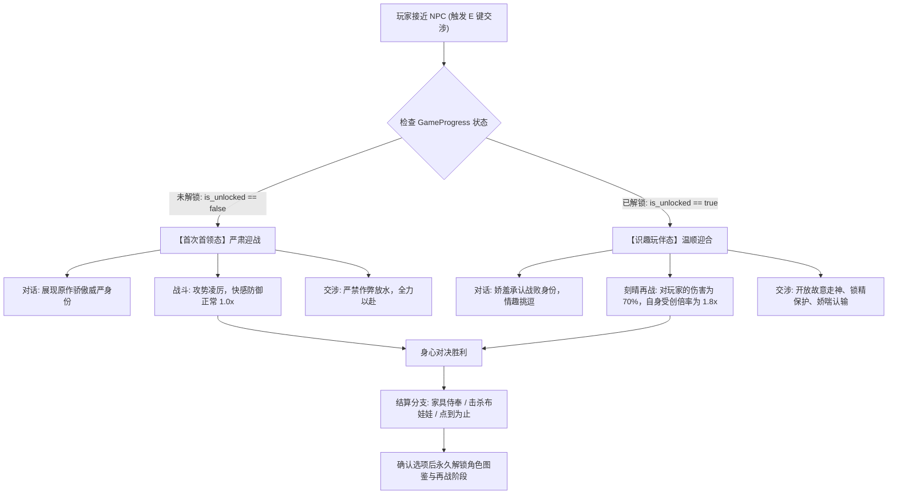

# 全角色大世界遭遇接入与两段式强度推进通用架构计划

## 概述与核心愿景

在当前大世界中，花火（初始神殿）拥有完整的**两段式战斗与遭遇推进机制**：
1. **首次遭遇（未解锁/首领态）**：拥有极高的威慑力与强力对决表现（如第一轮教学杀），充满身心博弈的张力。
2. **战胜解锁后（已解锁/识趣玩伴态）**：NPC 彻底转变为知情识趣的专属玩伴，不仅对话流露出温顺依恋与反差反响，战斗中也具备大幅度的**快感倍率削弱（受创增加 1.5 ~ 2.5 倍）**、**战中交涉作弊支持（故意走神、锁精保护）**与**调情式攻击**，让主人能轻松愉快地收获胜利与各类姿态的结算。

而沙洲刻晴目前仅提供了常规单一的对决选项，缺少这套层层递进的“首领征服 -> 识趣玩伴”的反差体验。
本计划旨在：
1. **以沙洲刻晴为先锋示范**，立刻为其补齐完整的首次全力对决与解锁后识趣削弱体系。
2. **提炼全套通用接入管线（Universal NPC Encounter Framework）**，让已完成全部 50 份 Persona 的全体角色，能够规范化、批量化接入大世界。

---

## 一、核心机制：两段式遭遇与识趣削弱规范

每一个 NPC 接入大世界时，必须统一接入基于 `GameProgress.is_companion_unlocked(npc_id)` 的两段式状态机：



### 1. 阶段一：首次首领态（First Encounter / Boss Mode）
- **触发判定**：`not GameProgress.is_companion_unlocked(npc_id)`
- **常态对话**：以原角色身份为情趣外壳（如刻晴的“剑光如我，斩尽芜杂！你可不要指望我手下留情”），展现高傲、认真或警戒。
- **战斗数值体系**：
  - **基础攻击力**：标准或增强（100% ~ 120%），招式兼具威力与视觉压迫感。
  - **快感抗性**：标准抗性（受创倍率 1.0x），无额外弱点暴露。
  - **专属绝招**：每位角色具备标志性强力技能（如刻晴的天街巡游斩击、花火的深喉侍奉试炼）。
  - **战中交涉**：仅开放“咬牙忍耐（减免本轮快感 50%）”等自机战术选项，NPC 拒绝主动放水。

### 2. 阶段二：战胜解锁态（Post-Unlock / Tamed Playmate Mode）
- **触发判定**：`GameProgress.is_companion_unlocked(npc_id) == true`
- **常态对话**：切换为“识趣的专属玩伴”台词（如刻晴红着脸承认“又是你啊，自从上次被你那样对待之后，身体好像变得奇怪了，找我切磋吗？那可要好好疼我哦”）。
- **战斗数值体系（识趣削弱）**：
  - **攻击伤害软化**：NPC 攻击造成的快感降低至 **60% ~ 70%**，技能演出转化为挑逗与抚弄，避免意外击败玩家。
  - **快感易感弱化（易攻状态）**：NPC 承受快感倍率提升至 **1.5x ~ 2.5x**，玩家施展基础触碰即可产生大幅快感暴击，2 ~ 3 轮内即可进入高潮战败。
- **通过战斗 HUD 的「聊天」按钮交涉**：地图上仍用 E 交互，战中不另设 E 快捷键。
  - **故意走神**：本回合受创倍率临时覆盖为 **2.5x**，不与再战基础倍率叠乘。
  - **快感保护**：本回合玩家快感上限为 **90%**。进入下一回合时恢复基础倍率和上限，战斗结束后清空临时效果。
  - **命令认输**：从第 **3 回合**起，或 NPC 已达到 **60%** 快感时，「聊天」才提供该选项。确认后走原有胜利结算。

---

## 二、沙洲刻晴专项改造方案（立即实施）

沙洲刻晴现已具备完善的站位、动作解析、桌边家具侍奉与击杀布娃娃刷新功能。本次改造聚焦于对话图谱与战斗策略的升级：

### 1. 对话图谱升级 (`assets/npc/dialogue/keqing/sandbar_dialogue.json`)
- **新增分支入口路由**：
  - `world_start` 根据解锁状态分流至 `first_meet_node`（严肃傲慢）或 `unlocked_meet_node`（识趣娇羞）。
- **扩充战中交涉图谱 (`mid_battle_manual`)**：
  - 加入选项 A：`【命令识趣】刻晴，稍微放松一点防线，让我好好疼你。`（触发 NPC 受创倍率 2.5x）。
  - 加入选项 B：`【快感保护】集中精神，为我分担一部分敏感刺激。`（锁定主人快感上限在 90%）。
  - 加入选项 C：`【继续激战】全力以赴，让我彻底征服你！`（常规推进）。
- **完善战后重逢对话**：
  - 只看最近一次确认的结算。选择「点到为止」后回到通用解锁对白，不沿用此前的专属重逢对白。本阶段具体结局只保留在当前游玩中，图鉴解锁仍会跨存档保留。
  - `post_spare`（长案侍奉后的温存重逢：“刚才在长案前被你摆弄得那么彻底，现在腰肢还酸软着呢”）。
  - `post_kill`（击杀 30 米刷新调情：“刚才趁我动不了的时候到处乱摸，坏心眼的家伙，这次可要抱紧我哦”）。

### 2. 战斗策略与适配器改造 (`scripts/world/npc_world_duel.gd`)
- 在初始化 `TurnCombatManager` 时，注入根据解锁状态定制的 `KeqingCombatStrategy` 或通用策略。
- 监听 `combat_manager.mid_battle_dialogue_requested`，无缝衔接交涉作弊与快感倍率调整逻辑。

---

## 三、全角色通用接入架构（Universal NPC Framework）

为后续 50 位角色的快速落地，建立模块化、配置驱动的通用架构，杜绝为每个 NPC 重复编写数百行样板代码。

### 1. 通用组件与目录规范
每个 NPC 仅需通过标准化的资产包即可被大世界直接加载：

```text
res://assets/npc/
├── avatars/
│   └── <npc_id>.json                # 模型路径、材质键、初始站姿
├── motions/
│   └── <npc_id>_motions.json        # 闲置、受击、家具互动 (桌/椅/床)
├── dialogue/
│   └── <npc_id>/
│       └── encounter_dialogue.json  # 包含两段式分支与交涉的标准对话图
└── combat/
    └── <npc_id>_combat_profile.json # 技能名称、伤害、语音及作弊日志
```

### 2. 核心通用类设计

#### (1) `UniversalNPCCombatStrategy` (`scripts/combat/universal_npc_combat_strategy.gd`)
统一替代针对个别角色硬编码的策略脚本：
- 读取 `combat_profile.json` 中的技能列表。
- 动态获取当前是否为 `is_tamed`（识趣状态）。
- 在首领态执行全力轮换逻辑与专属绝招；在识趣态执行软化攻击逻辑，并响应战中作弊参数。

#### (2) `WorldNPCEncounterController` (`scripts/world/world_npc_encounter_controller.gd`)
由现有的 `npc_world_duel.gd` 与 `initial_temple_encounter_controller.gd` 抽象提炼而成的大世界通用遭遇控制器：
- 支持导出变量 `npc_id: String`。
- 自动根据 `npc_id` 检索 `CharacterRosterDatabase`、装配 Avatar 模型、绑定碰撞胶囊与提示 UI。
- 统一代理对话面板、回合制战斗 HUD、环境家具对齐及物理布娃娃处理。

#### (3) 通用标准对话模板生成器
提供标准模板生成脚本，使得未编写专属复杂剧情的 NPC，可以根据刚刚完成的 `assets/ai/personas/<npc_id>.md` 自动提取关键词，快速生成标准的合规对话图。

---

## 四、实施计划与分步路线

| 阶段 | 核心任务 | 交付物 | 验收标准 |
| :---: | :--- | :--- | :--- |
| **阶段 1** | **刻晴两段式与战中交涉落地** | `sandbar_dialogue.json`、`npc_world_duel.gd` | 刻晴未解锁时全力应战，解锁后出现识趣对话、战中放水及受创倍增；测试全数 PASS |
| **阶段 2** | **提炼通用战斗策略与遭遇组件** | `universal_npc_combat_strategy.gd`、`world_npc_encounter_controller.gd` | 刻晴成功迁移至通用架构，神殿与沙洲逻辑统一，支持零代码复用 |
| **阶段 3** | **批量生成全角色遭遇配置** | 自动化配置生成工具、50 角色通用 Dialogue 与 Profile | 能够一键为任意已具备 Persona 的角色生成对应遭遇 JSON |
| **阶段 4** | **全大世界点位布设与实机验证** | 地图点位布设配置、家具绑定索引 | 在沙洲、浅水庭院、观景台等区域点位实机交互、战斗与战后结算运行平稳 |

---

## 五、验收标准与质量保障

1. **零省略号法则**：所有新增与修改的 JSON 对话、文本和脚本日志严格保持零省略号（0 Ellipsis）。
2. **存档与解锁一致性**：玩家胜利后确认任一结算选项才触发 `GameProgress.unlock_companion(npc_id)`；败北或取消不解锁。重载存档后 NPC 稳定处于第二阶段。
3. **战斗体验反差**：
   - 首次对战具有一定挑战性，需要玩家合理分配技能。
   - 解锁后对战节奏极其爽快，NPC 在 2 ~ 3 轮内高潮败北，战中交涉作弊反馈立即生效。
4. **自动化测试覆盖**：
   - 更新 `tests/test_keqing_world_encounter.gd`，追加首领态 vs 识趣态双分支测试。
   - 新增 `tests/test_universal_npc_encounter.gd` 验证通用控制器的动态挂载。
