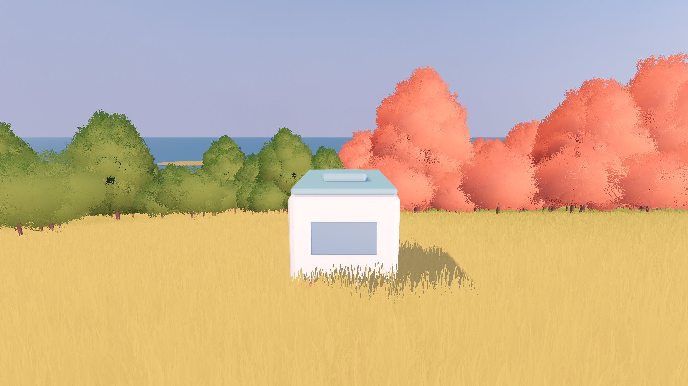
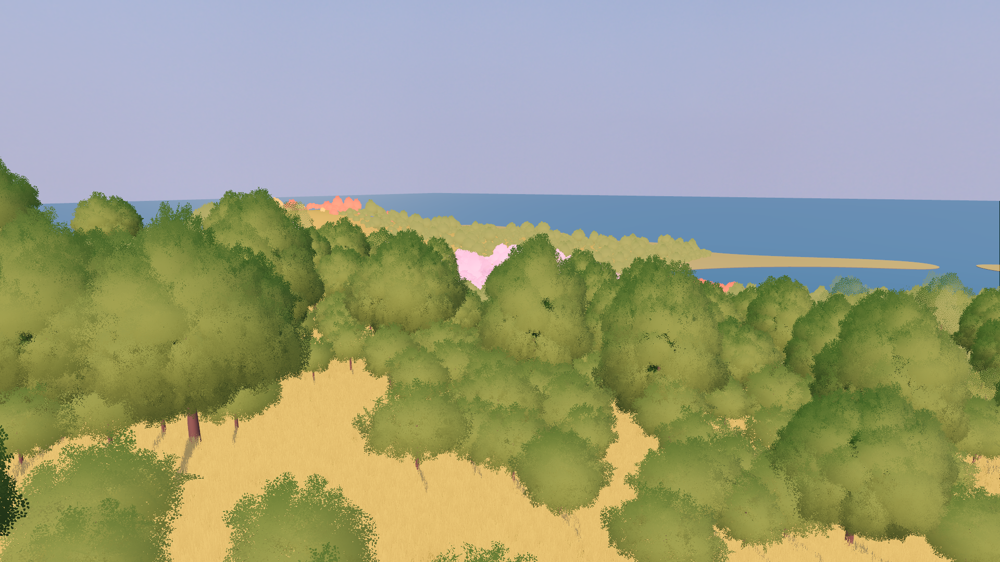
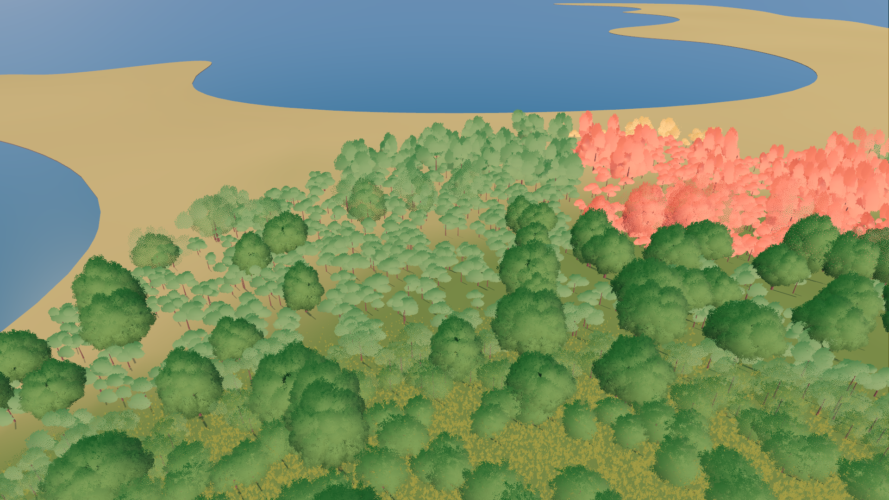
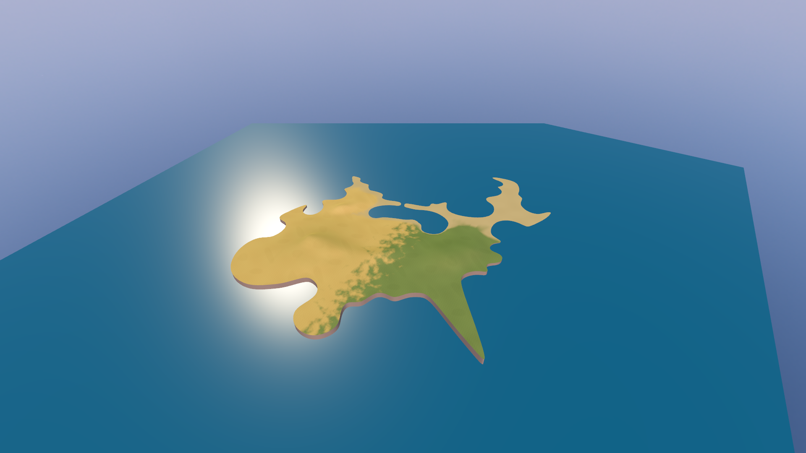
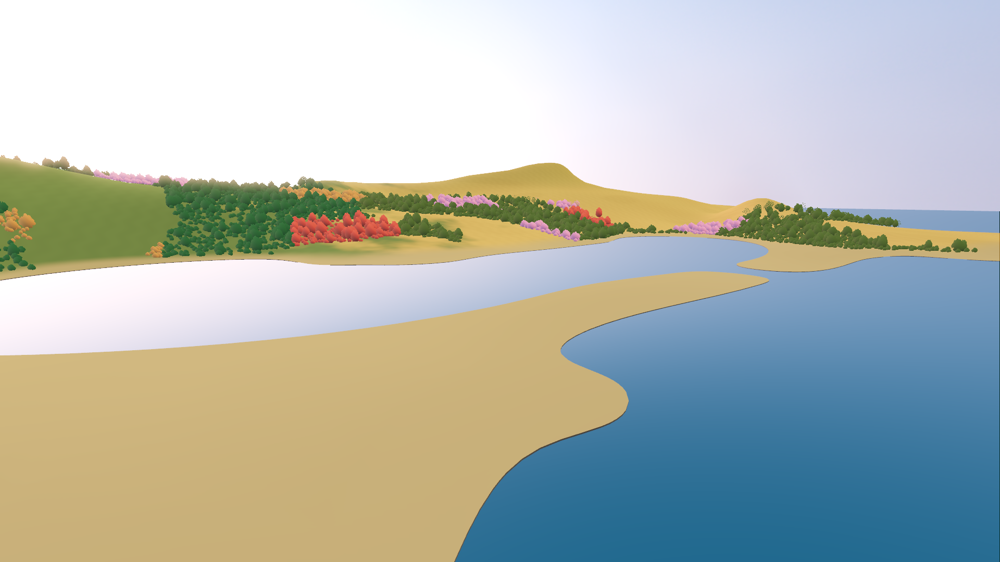
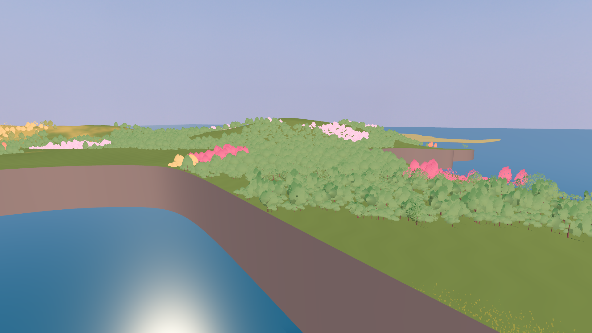

# 当前地图实机截图，2026-10-01

来源：`scenes/main.tscn`，当前已导入的地形和已接受的植物版本。
隐藏 HUD、冻结风和房车。尚未加入讨论中的巨构。

| 入口 | 岛内林地 |
| --- | --- |
|  |  |

| 坡地 | 全岛形体 |
| --- | --- |
|  |  |

| 较低海岸，Godot -Z 侧 | 崖岸，Godot +Z 侧 |
| --- | --- |
|  |  |

俯瞰镜头保持原距离裁剪，远处树不显示。±Z 没有被当成 CAD 的地理
南北定义。位置与镜头信息见 `capture_metadata.json`；方案见
`docs/ISLAND_MEGASTRUCTURE_TERRAIN_PLAN.md`。
